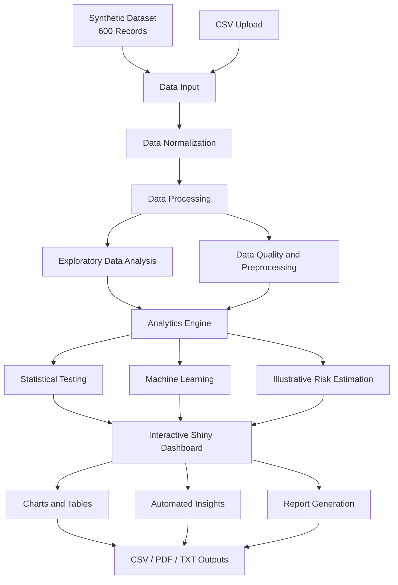

# ThyroidLab
Interactive R Shiny dashboard for thyroid and cardiovascular data analytics, featuring data visualization, preprocessing, statistical analysis, machine learning, risk estimation, and automated report generation.
# 🩺 ThyroidLab – Interactive Thyroid and Cardiovascular Data Analytics Dashboard

An interactive data science dashboard built with **R and Shiny** for exploring thyroid biomarkers, cardiovascular-related variables, statistical relationships, data quality, and machine learning results.

## 📌 Project Overview

ThyroidLab is a web-based analytical application developed as part of **CSI3004 – Data Science Programming**, School of Computer Science and Engineering (SCOPE).

The project integrates exploratory data analysis, interactive visualizations, statistical testing, data preprocessing, machine learning, and report generation into a unified dashboard.

Users can explore a built-in synthetic dataset or upload a compatible CSV file to perform different analytical operations through an interactive interface.

> **Disclaimer:** The default dataset contains synthetic demonstration data. The risk estimators are illustrative and are not clinically validated. This project is intended for educational purposes only and must not be used for medical diagnosis or treatment.

## ✨ Key Features

### 📊 1. Overview Dashboard
- Summary metrics for records, variables, age, and BMI.
- Numeric-data completeness visualization.
- Thyroid-status distribution.
- Age distribution and BMI comparisons.
- Interactive dataset preview.

### 📈 2. Distribution Lab
Explore numerical variables using:
- Histograms
- Density curves
- Box plots
- Violin plots
- Empirical cumulative distribution functions (ECDF)
- Q–Q plots
- Rug plots
- Frequency polygons

Users can select variables, compare groups, display mean reference lines, and inspect descriptive statistics.

### 🔗 3. Relationship Lab
Investigate relationships between numerical variables using:
- Scatter plots
- Scatter plots with regression lines
- Binned scatter plots
- Two-dimensional density contours
- Jitter plots

Additional visualizations explore age versus systolic blood pressure and TSH versus Free T4.

### 🧬 4. Correlation and Multivariate Analysis
- Pearson correlation heatmap.
- Ranking of pairwise correlations.
- Parallel-coordinate plots.
- Radar profiles.
- Pairwise scatter matrix.
- Group-wise descriptive summaries.

### 🧹 5. Data Explorer
- Upload compatible CSV datasets.
- Filter records by cardiovascular outcome and thyroid status.
- Search and sort records.
- Inspect data interactively.
- Download filtered data as CSV.
- Restore the built-in synthetic dataset.

### 🛠️ 6. Data Quality and Preprocessing
The application provides configurable preprocessing options:

- Retain or remove rows with missing values.
- Impute missing numerical values using the median.
- Impute missing categorical values using the mode.
- Remove duplicate records.
- Detect outliers using IQR or Z-score methods.
- Flag, winsorize, or remove outliers.
- Apply min–max normalization.
- Apply Z-score standardization.
- Review preprocessing logs and cleaned-data previews.
- Download cleaned datasets.

### 📐 7. Statistical Summary and Tests
- Mean, median, standard deviation, quartiles, and range.
- Missingness analysis.
- Pearson and Spearman correlation.
- Welch's independent t-test.
- Mann–Whitney U test.
- One-way ANOVA.
- Kruskal–Wallis test.
- Chi-square test of independence.
- Statistical result interpretation.

The available tests depend on the selected variables, observed groups, and data suitability.

### 🤖 8. Machine Learning
Train and evaluate classification models using:
- Logistic regression.
- Decision trees.
- Random forests.

Available evaluation outputs include:
- Confusion matrix.
- ROC curve.
- Feature-importance visualization where supported.
- Cross-validation summary where supported.
- Configurable predictors.
- Adjustable training/test split.
- Reproducible random seed.

### ❤️ 9. Risk Estimator
The application includes two separate illustrative estimators.

**Cardiovascular estimator**
- Age
- BMI
- Systolic blood pressure
- HDL cholesterol
- Diabetes
- Smoking

**Thyroid estimator**
- Age
- TSH
- Free T3
- Free T4
- TPO antibodies

These estimates demonstrate logistic-regression-based probability calculations and are not validated medical risk scores.

### 📄 10. Insights and Reports
- Automated analytical insights.
- Dataset analysis snapshot.
- Downloadable PDF report.
- Downloadable text insights.
- Cleaned CSV export.

## 🧰 Technologies Used

| Technology | Purpose |
|---|---|
| R | Data analysis and statistical computing |
| Shiny | Interactive web application |
| ggplot2 | Statistical visualization |
| Plotly | Interactive charts |
| DT | Interactive data tables |
| Base R and stats | Statistical calculations and hypothesis testing |
| rpart | Decision tree classification |
| randomForest | Random forest classification |
| scales | Numeric formatting |

## 🏗️ System Architecture

The application follows a modular, reactive data analytics workflow.



## 📂 Project Structure

A recommended repository structure is:

```text
ThyroidLab/
├── dsp.R
├── README.md
├── data/
│   └── sample_dataset.csv
├── screenshots/
│   ├── login.png
│   ├── overview.png
│   ├── distribution-lab.png
│   ├── relationship-lab.png
│   ├── data-quality.png
│   └── machine-learning.png
└── LICENSE
```

**Note:** The structure above is a suggested organization. The built-in synthetic dataset is generated by the R application, so a separate CSV file is optional. Include only files that actually exist in your repository.

## ⚙️ Installation and Setup

### Prerequisites

Install the following software:

- [R](https://cran.r-project.org/)
- [RStudio Desktop](https://posit.co/download/rstudio-desktop/)

### Step 1: Clone the Repository

Replace the example URL with your actual GitHub repository URL.

```bash
git clone https://github.com/YOUR-USERNAME/ThyroidLab.git
cd ThyroidLab
```

Alternatively, download the repository as a ZIP file from GitHub and extract it.

### Step 2: Install Required R Packages

Open the project in RStudio and execute:

```r
install.packages(c(
  "shiny",
  "ggplot2",
  "plotly",
  "DT",
  "scales",
  "rpart",
  "randomForest"
))
```

Install the packages only once unless you need to update them.

### Step 3: Run the Application

If your R application file is named `dsp.R`, execute:

```r
shiny::runApp("dsp.R")
```

If RStudio is already opened in the directory containing `dsp.R`, you can also run the application from the R console using:

```r
shiny::runApp()
```

The dashboard should open in your default web browser or the RStudio viewer.

## 🔐 Demo Login

The uploaded source code contains the following demonstration login credentials:

| Field | Value |
|---|---|
| Username | `adithya` |
| Password | `123` |

**Security note:** These are hardcoded demonstration credentials, not production-grade authentication. Do not use them to protect sensitive information or deploy the application as a secure medical service.

## 📊 Dataset Information

The application generates **600 synthetic records** by default.

The generated dataset includes:

- Patient ID
- Age and gender
- BMI
- TSH, Free T3, and Free T4
- TPO antibodies
- HDL and total cholesterol
- Systolic and diastolic blood pressure
- Diabetes and smoking status
- Thyroid status
- Cardiovascular outcome label

The application also supports CSV uploads. Uploaded files must contain the columns required by the application, with compatible column names and data types.

**Important:** The synthetic data is generated for demonstration. Patterns and model results from this dataset should not be interpreted as findings about real patients.

## 🖥️ Screenshots

Add screenshots of your running application to the `screenshots/` directory and use the following Markdown to display them in the README.

### Overview Dashboard

```markdown

```

### Distribution Lab

```markdown

```

### Relationship Lab

```markdown

```

### Data Quality

```markdown

```

### Machine Learning

```markdown

```

Replace these example image paths with the actual screenshot filenames you upload.

## 🎯 Learning Outcomes

This project demonstrates practical experience in:

- R programming and reactive web application development.
- Exploratory data analysis.
- Interactive statistical visualization.
- Data quality assessment and preprocessing.
- Descriptive statistics and hypothesis testing.
- Correlation and multivariate analysis.
- Classification algorithms and model evaluation.
- CSV import, filtering, and export.
- Automated insight generation and report creation.

## ⚠️ Limitations

- The default dataset is synthetic and is not clinical evidence.
- Risk estimators are illustrative and not clinically validated.
- Model performance on synthetic data does not establish real-world predictive accuracy.
- Uploaded CSV files must satisfy the application's schema requirements.
- The demonstration login is hardcoded and is not suitable for production security.

## 🚀 Future Enhancements

Potential improvements include:

- Integration with validated, appropriately authorized datasets.
- More extensive model validation and performance comparisons.
- Enhanced dataset validation and error reporting.
- Additional visualization and feature-selection techniques.
- Improved authentication and access control.
- Expanded export options and customizable reports.
- Deployment using an appropriate Shiny hosting platform.

## 👨‍🎓 Academic Information

**Course:** CSI3004 – Data Science Programming  
**School:** School of Computer Science and Engineering (SCOPE)  
**Faculty In-charge:** Dr. M. A. Berlin

**Team Members:**
-   MANTHENA SRI ADITHYA

## 📜 License

No license has been specified yet. If you intend to make the repository open source, choose an appropriate license and add the corresponding `LICENSE` file.

---

**ThyroidLab — Explore data. Discover patterns. Understand analytics.**

